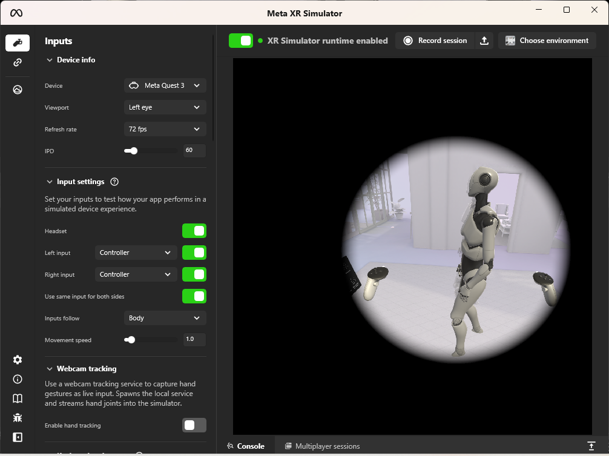
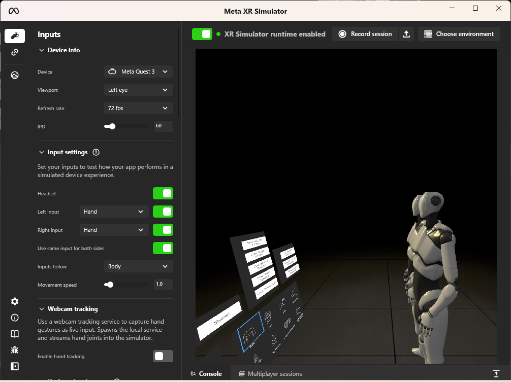
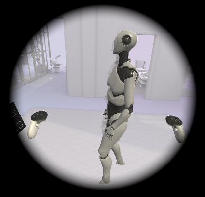
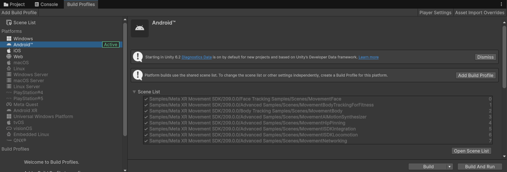

# Demo Full Body Tracking với Controller và Hand
{: .no_toc }

<details open markdown="block">
  <summary>Mục lục</summary>
  {: .text-delta }
1. TOC
{:toc}
</details>

---

Trước khi bắt đầu, cần hoàn thành [Setup](setup) và [Simulator](simulator).

## 1. Body tracking với Controller (`MovementBody`)
{: #step-1 }

1. Mở scene `Assets/Samples/Meta XR Movement SDK/209.0.0/Body Tracking Samples/Scenes/MovementBody.unity`.
2. Trong Simulator, mở **Inputs**, đặt **Left/Right input = Controller**.
3. Bấm **Play**. Nhân vật được retarget theo dữ liệu body tracking. Di chuyển headset và controller thì thân và tay nhân vật cử động theo.



## 2. Body tracking với Hand tracking
{: #step-2 }

1. Vẫn dùng scene `MovementBody`, đổi **Left/Right input = Hand** trong Simulator.
2. Dùng các phím trong **Input bindings → Hand actions** để làm cử chỉ (pinch, grab…). Ngón tay của nhân vật đi theo hand tracking.



### Phát lại dữ liệu body đã ghi

Khi đang Play, mở **Tracking controls** trong panel Inputs của Simulator và chọn một recording. Nhân vật sẽ cử động toàn thân theo dữ liệu đó, kể cả chân.

{: .note }
> Console có thể báo `[OVRBody] Failed to start body tracking with joint set FullBody.` Nếu sau đó nhân vật vẫn cử động bình thường thì bỏ qua được. Nếu không, đổi **Body Tracking Joint Set** sang **Upper Body** trong OVRManager, hoặc test trên Quest thật. Xem [Issue #6](issues#issue-6).

## 3. Locomotion character (`MovementISDKLocomotion`)
{: #step-3 }

Scene nằm ở `Advanced Samples/Scenes/MovementISDKLocomotion.unity`. Nhân vật chạy các animation **Run / RunBackward / Strafe** dựa trên **locomotion event** của Interaction SDK: slide, teleport và turn.

Cơ chế: `LocomotionSkeletalProcessor` lắng nghe `WhenLocomotionEventHandled`, lấy vận tốc tịnh tiến rồi set hai tham số `Horizontal`/`Vertical` của Animator `LocomotionController`.

| Thao tác | Kết quả |
|---|---|
| **Thumbstick trái** đẩy tới/lùi/ngang | Nhân vật chạy tới, lùi hoặc strafe |
| **Thumbstick trái** kéo rồi thả | Teleport |
| **Thumbstick phải** gạt trái/phải | Snap turn |
| WASD trên bàn phím | Chỉ di chuyển headset, **nhân vật không chạy** |

Trong Simulator: đặt input = **Controller**, rồi xem phím gán cho thumbstick trong **Input bindings**. Cách dễ nhất là cắm tay cầm **Xbox**.

Khi đang slide, sample bật **comfort vignette**: viền tối bao quanh, chỉ chừa một vòng tròn ở giữa. Nhân vật chuyển sang animation chạy:



## 4. Test trên Quest thật
{: #step-4 }

1. **File → Build Profiles**, chuyển sang **Android** (phải hiện **Active**), kiểm tra Scene List, rồi chọn **Build And Run**.

   

2. Hoặc cài và chạy bằng [`hzdb`](https://github.com/meta-quest/agentic-tools):

```bash
npx -y @meta-quest/hzdb device list
npx -y @meta-quest/hzdb app install path/to/build.apk
```

3. Lần chạy đầu, headset sẽ hỏi quyền **Body / Face / Eye tracking**. Cần đồng ý hết.
