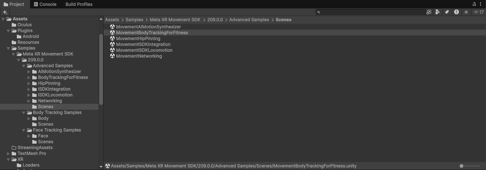

# Meta XR Movement SDK trên Unity 6
{: .fs-9 }

Hướng dẫn từng bước dựng một project Unity 6 để test **Body, Face và Eye Tracking** bằng Meta XR Movement SDK. Bạn test được trên PC bằng **Meta XR Simulator** mà không cần đeo Quest. Tài liệu cũng tổng hợp các lỗi đã gặp trong quá trình setup và cách sửa từng lỗi.
{: .fs-6 .fw-300 }

[Bắt đầu setup](setup){: .btn .btn-primary .fs-5 .mb-4 .mb-md-0 .mr-2 }
[Lỗi & cách sửa](issues){: .btn .fs-5 .mb-4 .mb-md-0 }

---

## Môi trường đã kiểm chứng

| Thành phần | Phiên bản |
|---|---|
| Unity Editor | 6000.3.9f1 (Unity 6.3 LTS), có Android Build Support |
| Meta XR Movement SDK (`com.meta.xr.sdk.movement`) | 209.0.0 |
| Meta XR Core SDK (`com.meta.xr.sdk.core`) | 209.0.0 |
| Meta XR Interaction SDK (`com.meta.xr.sdk.interaction.ovr`) | 209.0.0 |
| Unity OpenXR Plugin (`com.unity.xr.openxr`) | 1.16.1 |
| Unity Test Framework | 1.6.0 |
| Meta XR Simulator | v207.1 |
| Hệ điều hành | Windows 11 |

Movement SDK 209.0.0 yêu cầu tối thiểu **Unity 6000.0.66f2**. Xem `package.json` và `README.md` của [repo gốc](https://github.com/oculus-samples/Unity-Movement).

## Nội dung

1. [Setup project](setup): tạo project, cài package, cấu hình XR, layer, OVRManager, import sample.
2. [Meta XR Simulator](simulator): bật Simulator và cấu hình input.
3. [Demo Full Body Tracking](demo): chạy demo với controller, hand tracking và locomotion.
4. [Lỗi & cách sửa](issues): các lỗi gặp thực tế, nguyên nhân và cách sửa.

