# Pipeline Retargeting
{: .no_toc }

Retargeting là quá trình chuyển dữ liệu body tracking sang một nhân vật bất kỳ. Dữ liệu nguồn (**source**) là skeleton body tracking của Meta, gồm 84 joint. Nhân vật đích (**target**) là rig của bạn: FBX hoặc prefab. Trang này mô tả pipeline của Movement SDK 209.0.0 ở hai giai đoạn: lúc cấu hình trong Editor và lúc chạy mỗi frame.

  
Mục lục

  {: .text-delta }
1. TOC
{:toc}

---

## Tổng quan
{: #overview }

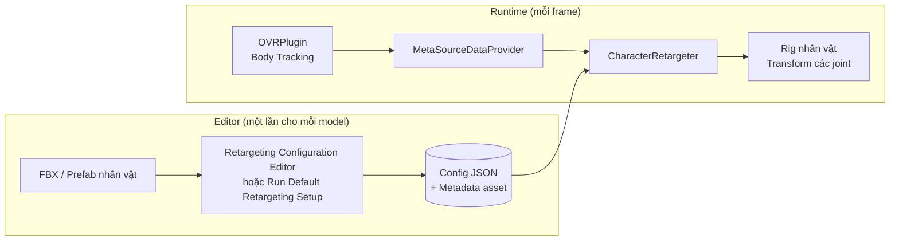

| Thành phần | Vai trò |
|---|---|
| **Config JSON** | Ánh xạ joint source ↔ target, T-pose min/max, các joint được retarget. Sinh ra bằng editor tool. |
| **Metadata asset** (`<Model>-metadata.asset`) | Liên kết config JSON với model, lưu thông tin để chạy lại setup. |
| **`MetaSourceDataProvider`** | Cung cấp pose source. Kế thừa `OVRBody`, cài đặt `ISourceDataProvider`, có thể trộn thêm AI Motion Synthesizer. |
| **`CharacterRetargeter`** | Chạy retargeting mỗi frame: source processors → native retargeter → target processors → gán pose lên rig. |
| **`SkeletonRetargeter`** | Lớp bao lớp native retargeting (MSDK Utility), giữ handle config và các buffer pose. |

---

## Giai đoạn 1: Tạo cấu hình retargeting (Editor)
{: #step-1 }

### Chuẩn bị model

- Import FBX hoặc prefab vào `Assets/`. Rig nên là **humanoid** và có **scale đồng nhất** ở các joint. Tool sẽ ép root joint về scale `1` nếu scale không đồng nhất.
- Chiều cao nhân vật nên nằm trong khoảng **1,0–2,5 m**. Từ bản 209, tool cảnh báo khi nhân vật nằm ngoài khoảng này và gợi ý **Scale Factor** cần đặt trong FBX importer.

### Cách A: Run Default Retargeting Setup (nhanh)

Click chuột phải vào model trong cửa sổ **Project**, chọn **Movement SDK → Body Tracking → Run Default Retargeting Setup**.

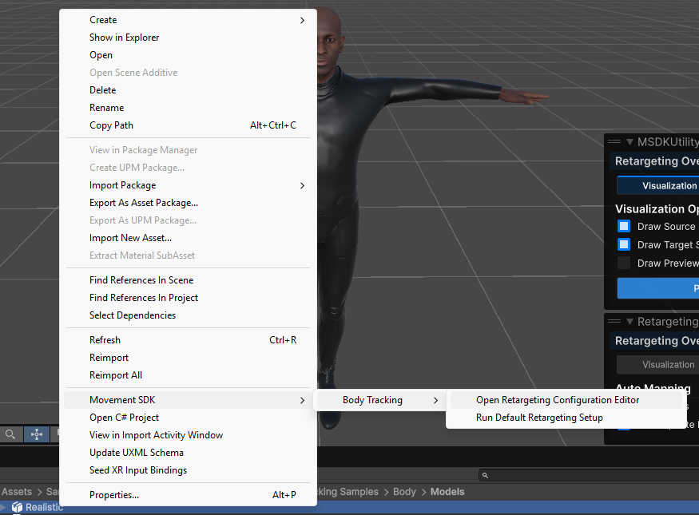

Lệnh này làm giống hệt mở Configuration Editor rồi bấm *Next → Next → Next → Validate and save config* mà không sửa gì, chỉ khác là không mở cửa sổ nào. Kết quả gồm **config JSON** và **metadata asset**. Chạy lại lệnh thì config được dựng lại từ model hiện tại, vẫn giữ known joints, các joint loại khỏi auto-mapping và các joint đã xóa.

### Cách B: Retargeting Configuration Editor (tinh chỉnh)

Click chuột phải vào model, chọn **Movement SDK → Body Tracking → Open Retargeting Configuration Editor**. Nếu chưa có config JSON, tool hỏi tạo mới: chọn **Create** và chọn nơi lưu.

Editor mở tab **Retargeting Editor** ở panel bên trái, và Scene view chuyển sang một scene preview riêng (breadcrumb ghi **Realistic Config**) chứa một `PreviewCharacter`. Góc dưới bên phải Scene view có 2 overlay:

- **MSDKUtilityEditorOverlay → Visualization**: bật/tắt **Draw Source Skeleton**, **Draw Target Skeleton**, **Draw Preview Skeleton**, và nút **Preview Scale**.
- **Retargeting Tool → Joint Mapping**: **Auto Mapping** gồm **Map Twists** và **Auto Update Mappings**.

Panel bên trái có thanh tiêu đề **Retargeting Setup** với số bước `1 / 4` … `4 / 4`, kèm hai trường **Scene View Character** và **Config Asset**. Cạnh Config Asset có 3 nút: lưu, tải lại, tạo mới.

#### Bước 1/4: Setup Configuration

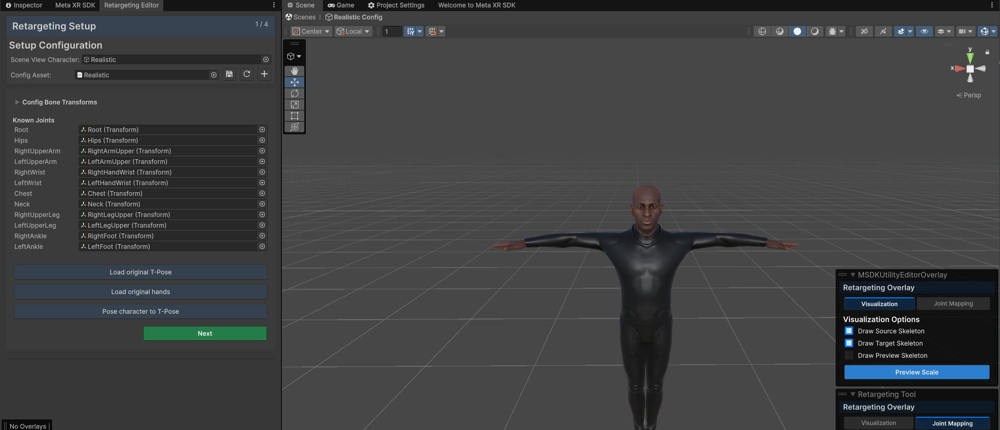

- **Known Joints**: tool tự dò các joint chuẩn (Root, Hips, Right/LeftUpperArm, Right/LeftWrist, Chest, Neck, Right/LeftUpperLeg, Right/LeftAnkle). Kiểm tra lại, nếu sai thì kéo đúng Transform vào.
- **Config Bone Transforms** (bấm để mở rộng): danh sách bone được retarget. Bỏ những bone không cần retarget, ví dụ bone có animation riêng hoặc dùng cho IK.

  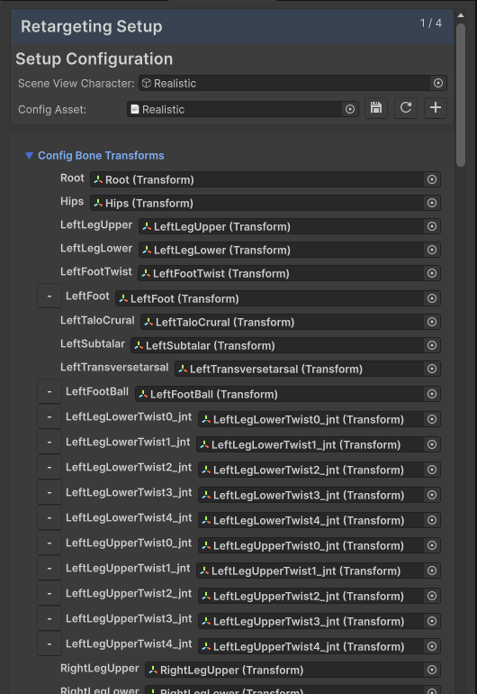

- **Load original T-Pose**: nạp lại T-pose đã lưu trong config. **Load original hands**: chỉ nạp lại pose bàn tay. **Pose character to T-Pose**: tự đưa nhân vật về T-pose, dùng khi model đang ở A-pose.
- Bấm **Next**. Hộp thoại **Save Configuration Changes** hiện lên:

  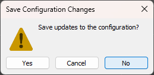

  - **Yes**: lưu rồi sang bước tiếp.
  - **No**: không lưu nhưng vẫn sang bước tiếp. Nên chọn No khi chỉ xem thử config của sample.
  - **Cancel**: ở lại bước hiện tại.

#### Bước 2/4: Align Min T-Pose

Căn nhân vật theo skeleton source **nhỏ nhất** (người thấp). Skeleton màu xanh lá là skeleton source.

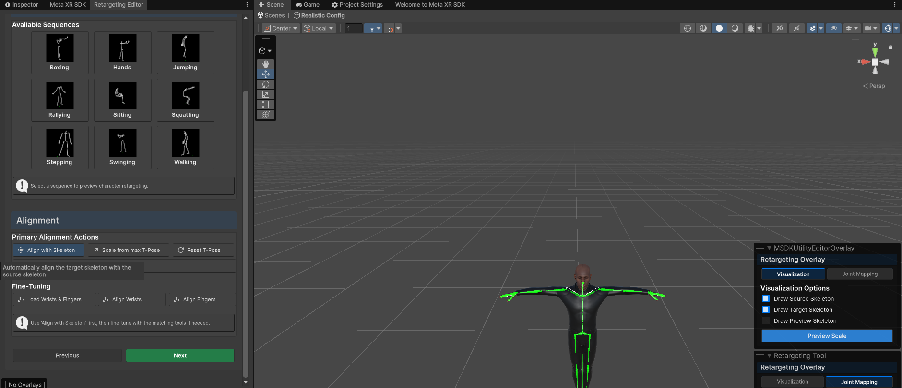

- **Primary Alignment Actions**:
  - **Align with Skeleton**: tự căn skeleton nhân vật theo skeleton source. Nên bấm nút này trước.
  - **Scale from max T-Pose**: co giãn nhân vật lấy T-pose bên kia làm chuẩn.
  - **Reset T-Pose**: trả nhân vật về T-pose mặc định.
- **Fine-Tuning**: **Load Wrists & Fingers**, **Align Wrists**, **Align Fingers** để chỉnh riêng cổ tay và ngón tay sau khi đã căn chung.
- **Preview Sequences**: chọn một chuỗi chuyển động (Boxing, Hands, Jumping, Rallying, Sitting, Squatting, Stepping, Swinging, Walking). Một nhân vật preview sẽ chạy bên cạnh. Mục **Playback** có thanh thời gian và nút tạm dừng/dừng. Chỉnh T-pose bằng transform tool của Unity thì preview cập nhật ngay.

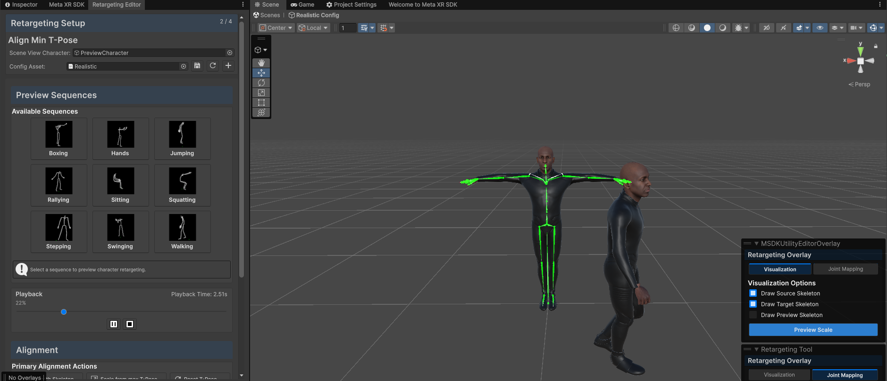

#### Bước 3/4: Align Max T-Pose

Như bước 2 nhưng căn theo skeleton source **lớn nhất** (người cao). Nút scale ở bước này là **Scale from min T-Pose**.

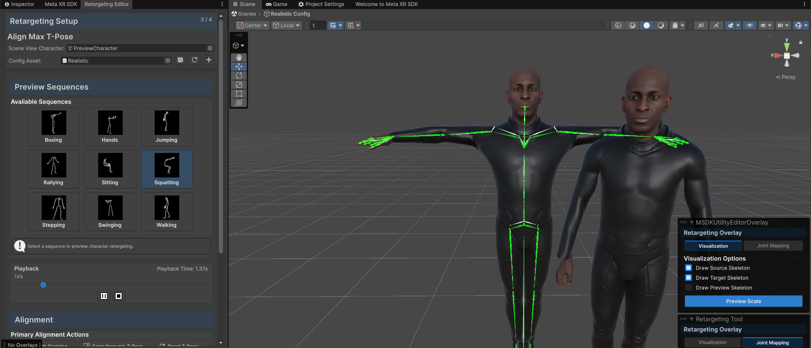

#### Bước 4/4: Review & Export

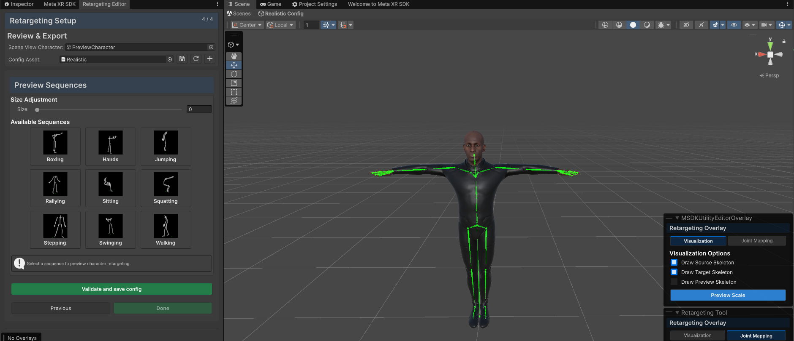

- **Size Adjustment**: kéo thanh **Size** để xem nhân vật co giãn giữa Min và Max T-Pose, kết hợp với Preview Sequences.
- **Validate and save config**: kiểm tra rồi ghi config JSON. Bấm **Done** để thoát editor.

{: .warning }
> Khi chỉ xem thử config của sample (`Realistic`, `StylizedCharacter`…), **đừng bấm Validate and save config** và luôn chọn **No** ở hộp thoại lưu. Nếu không, config gốc của sample sẽ bị ghi đè.

{: .tip }
> Mesh có bounds nhỏ có thể bị Unity cull (không skin) khi người dùng vươn tay ra xa. Hãy tăng bounds bằng **Edit Bounds** trong Skinned Mesh Renderer, hoặc bật **Update When Offscreen**. Cách thứ hai tốn thêm CPU.

### Gắn retargeter vào nhân vật

1. Kéo model hoặc prefab vào scene.
2. Click chuột phải vào object trong **Hierarchy**, chọn **Movement SDK → Body Tracking → Add Character Retargeter**.

Lệnh này:
- Tạo hoặc lấy lại metadata của model.
- Thêm `CharacterRetargeter` và gán **Config** = config JSON.
- Thêm `MetaSourceDataProvider` với **Body Joint Set = Full Body**. Trong code field này là `ProvidedSkeletonType`.

**Character Retargeter** trong Inspector (nhân vật `StylizedCharacter` của scene `MovementBody`):

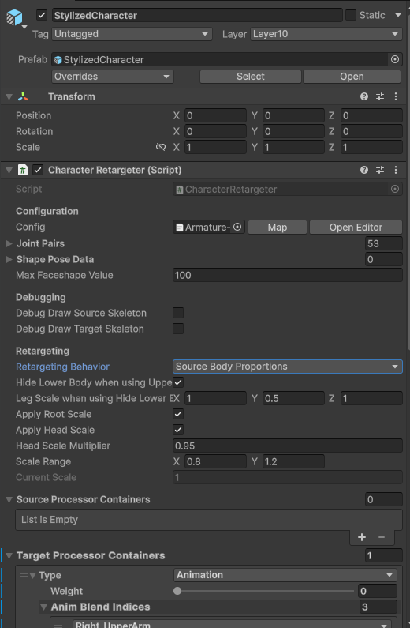

| Nhóm | Field |
|---|---|
| Configuration | **Config** (file JSON), nút **Map** và **Open Editor** (mở Retargeting Configuration Editor), **Joint Pairs**, **Shape Pose Data**, **Max Faceshape Value** |
| Debugging | **Debug Draw Source Skeleton**, **Debug Draw Target Skeleton** |
| Retargeting | **Retargeting Behavior**, **Hide Lower Body when using Upper Body**, **Leg Scale when using Hide Lower Body**, **Apply Root Scale**, **Apply Head Scale**, **Head Scale Multiplier**, **Scale Range**, **Current Scale** |

**Processors** và **Meta Source Data Provider**:

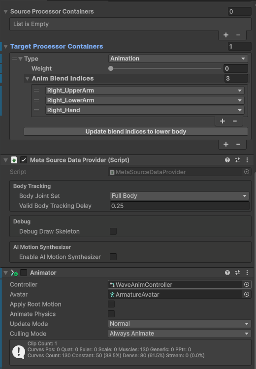

- `StylizedCharacter` không có source processor nào. Nó có 1 target processor loại **Animation**, với **Anim Blend Indices** = `Right_UpperArm`, `Right_LowerArm`, `Right_Hand`. Đây là animation vẫy tay phải, điều khiển bằng `WaveAnimController` trên component **Animator**.
- **Meta Source Data Provider** gồm: **Body Joint Set**, **Valid Body Tracking Delay** (0.25 s), **Debug Draw Skeleton**, **Enable AI Motion Synthesizer**.

Khi chọn một nhân vật có `CharacterRetargeter` trong scene thường, overlay **Retargeting Tool** cũng hiện ra. Chế độ **Joint Mapping** vẽ các khối xanh dương thể hiện ánh xạ joint:

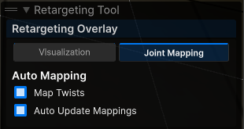

{: .note }
> Docs cũ ghi là thêm `OVRBody`. Từ bản 209, nếu nhân vật còn component `OVRBody`, inspector của `CharacterRetargeter` sẽ hiện cảnh báo kèm nút **Fix** để thay bằng `MetaSourceDataProvider`. Thao tác này undo được.

Nếu object được chọn không phải rig hợp lệ, tool sẽ mở hộp thoại để chọn model (`fbx`, `obj`, `3ds`, `glb`, `prefab`), đưa model vào scene và yêu cầu bạn chạy lại lệnh trên object mới.

Muốn chỉnh tiếp config của một nhân vật đã có trong scene thì chọn nhân vật đó, rồi vào **GameObject → Movement SDK → Body Tracking → Open Retargeting Configuration Editor**.

---

## Giai đoạn 2: Pipeline runtime (mỗi frame)
{: #step-2 }

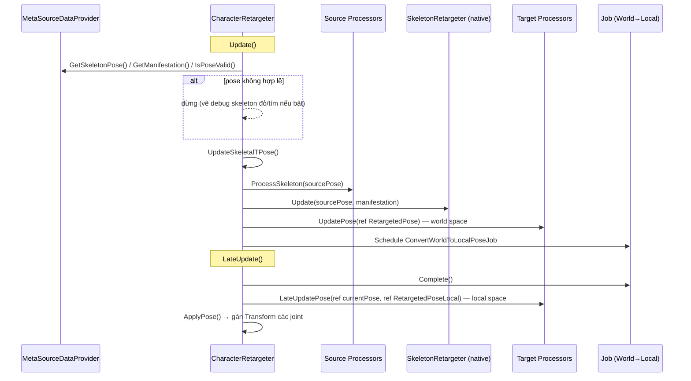

### Thứ tự xử lý

1. **`Awake`**: tìm component `ISourceDataProvider` trên cùng GameObject. Bắt buộc phải có cả config lẫn provider, thiếu một trong hai thì assert fail.
2. **`Start` → `Setup(config)`**: khởi tạo native retargeter từ config JSON, tính `HipsScale`, gọi `Initialize` cho từng source/target processor. `Setup` chỉ chạy một lần.
3. **`Update`**:
   - Lấy pose source, *manifestation* (Full Body / Upper Body…) và cờ hợp lệ từ provider.
   - Cập nhật T-pose tham chiếu của source theo người dùng.
   - Nếu đã **Calibrate**, căn pose theo T-pose đã cố định.
   - **Source processors** chỉnh pose source, ví dụ trộn hand tracking của ISDK.
   - **Native retargeting** tính `RetargetedPose` trong world space.
   - **Target processors** (`UpdatePose`) chỉnh pose đích trong world space.
   - Đưa việc chuyển world → local vào một **Burst job** chạy song song.
4. **`LateUpdate`**: chờ job xong, chạy **target processors** (`LateUpdatePose`) trên pose local, rồi `ApplyPose()` gán vào Transform của rig.

{: .note }
> `LateUpdate` chạy sau Animator. Nhờ vậy `AnimationSkeletalProcessor` và `LocomotionSkeletalProcessor` đọc được pose do animation tạo ra rồi trộn với body tracking trước khi gán vào rig.

### Processors

Processors chạy **theo thứ tự trong danh sách**. Thêm processor ở **Source Processors** hoặc **Target Processors** trong inspector của `CharacterRetargeter`, rồi chọn loại ở dropdown.

| Processor | Loại | Công dụng |
|---|---|---|
| `ISDKSkeletalProcessor` | Source | Trộn hand tracking của Interaction SDK vào joint thân, vẫn giữ hình dạng bàn tay của body. |
| `TwistSkeletalProcessor` | Target | Phân bổ xoắn lên các twist joint, sửa lỗi "candy wrapping" ở cổ tay. Thêm 2 processor (trái/phải), rồi bấm **Fill Left/Right Arm Indices** và **Estimate Twist Axis**. |
| `AnimationSkeletalProcessor` | Target | Trộn animation keyframe với body tracking theo mask **Anim Blend Indices**, ví dụ chỉ tay phải vẫy. |
| `LocomotionSkeletalProcessor` | Target | Nghe locomotion event của ISDK (slide, teleport, turn), set `Horizontal`/`Vertical` cho Animator. Dùng kèm Animation processor. |
| `HipPinningSkeletalProcessor` | Target | Ghim hông nhân vật vào một vị trí, ví dụ khi người dùng ngồi trên ghế. |
| `CCDSkeletalProcessor` | Target | Giải IK kiểu CCD cho một chuỗi bone để chạm tới target, ví dụ đặt tay vào pose tùy ý. |
| `HandSkeletalProcessor` | Target | Ép bone bàn tay theo một bàn tay tùy chỉnh, chạy IK cho phần còn lại. |
| `CustomProcessor` | Target | Gọi một `CustomProcessorBehavior` do bạn tự viết (kế thừa class này). |

#### Ví dụ: ISDK Locomotion + body tracking

Đây là cách scene `MovementISDKLocomotion` được dựng:

1. Tích hợp ISDK Locomotion vào scene.
2. Trên `CharacterRetargeter`, thêm target processor **Locomotion** và **Animation**.
3. Bấm **Setup** trên Locomotion processor.
4. Bấm **Update blend indices to lower body** trên Animation processor. Docs Meta gọi nút này là *Update anim blend indices with lower body*.
5. Gán một Animator Controller có blend tree locomotion. Trong sample đó là `LocomotionController`, với tham số `Horizontal`/`Vertical`.

Kết quả: khi đẩy thumbstick, animation chạy sẽ thay phần thân dưới. Khi đứng yên thì body tracking điều khiển toàn thân. Xem [Demo §3](demo#step-3).

### Các tùy chọn retargeting quan trọng

**Retargeting Behavior** quyết định tỉ lệ cơ thể:

| Tên trong Inspector | Giá trị enum | Ý nghĩa |
|---|---|---|
| Source Body Proportions | `RotationsAndPositions` | Lấy cả xoay và vị trí, nhân vật biến dạng theo tỉ lệ người dùng. |
| Source Body Proportions + Target Hand Proportions | `RotationsAndPositionsHandsRotationOnly` | Như trên nhưng giữ nguyên tỉ lệ bàn tay của nhân vật. |
| Source Body Proportions + Target Scale | `RotationAndPositionsUniformScale` | Theo tỉ lệ người dùng nhưng co giãn đều theo scale nhân vật. |
| Target Body Proportions | `RotationOnlyNoScaling` | Chỉ lấy xoay, giữ nguyên tỉ lệ và scale của nhân vật. |

Các field khác của `SkeletonRetargeter` trong Inspector (giá trị mặc định ghi trong ngoặc):

| Field | Ý nghĩa |
|---|---|
| **Apply Root Scale** (bật) | Co giãn cả nhân vật theo chiều cao người dùng, trong giới hạn **Scale Range** (0,8–1,2). |
| **Apply Head Scale** (bật) | Co giãn đầu theo **Head Scale Multiplier** (0,95). Từ bản 209, field này vẫn hiện kể cả khi Apply Root Scale đang tắt. |
| **Hide Lower Body when using Upper Body** | Ẩn chân, scale về **Leg Scale when using Hide Lower Body**, khi chỉ có dữ liệu thân trên. Mặc định trong code là tắt. `StylizedCharacter` của sample bật sẵn với Leg Scale = (1; 0,5; 1). |

**Root motion** không chỉnh trong Inspector. Nó là tham số `RetargetingRootMotionBehavior` của API native (`MSDKUtility`), gồm: `CombineHipRotationIntoRoot` (mặc định khi khởi tạo tham số), `RootFlatTranslationFullHipRotation` (hành vi mặc định của MSDK OpenXR theo chú thích trong code) và `ZeroOutAllRootTranslationAndHipYaw` (khóa nhân vật ở gốc, luôn quay mặt về phía trước).

### Debug

Inspector của `CharacterRetargeter` hiện 2 tùy chọn trong nhóm **Debugging**: **Debug Draw Source Skeleton** và **Debug Draw Target Skeleton**. `MetaSourceDataProvider` có thêm **Debug Draw Skeleton** để vẽ skeleton body tracking nguồn.

| Skeleton | Màu mặc định |
|---|---|
| Source | Xanh nhạt |
| Target | Cam nhạt |
| Source / Target không hợp lệ | Tím / đỏ: pose không hợp lệ, ví dụ mất tracking |

Code còn có tùy chọn vẽ T-pose (source xanh, target cam). Tùy chọn này là field serialized nhưng không hiện trong nhóm Debugging ở Inspector mặc định.

Ảnh dưới chụp lúc Play với Meta XR Simulator khi đã bật debug draw. Skeleton trắng trong khung nhìn Simulator là skeleton body tracking vẽ chồng lên nhân vật:

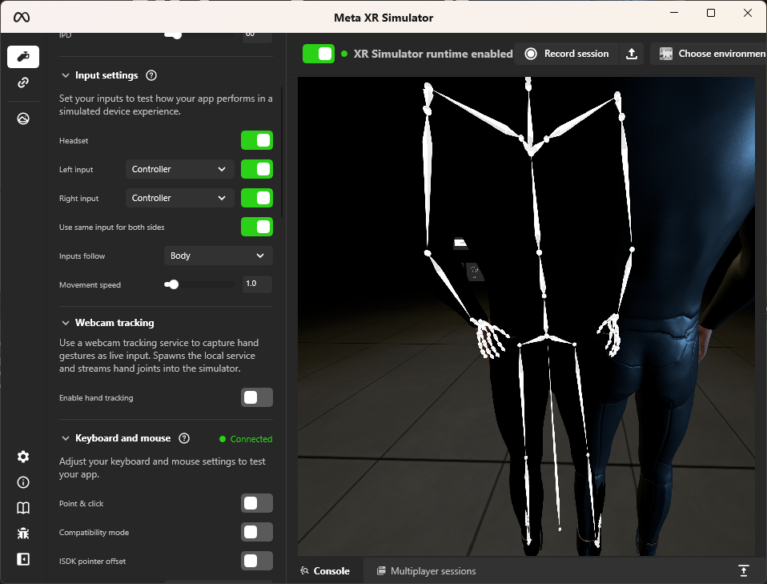

Thấy skeleton **tím hoặc đỏ** khi chạy bằng Simulator nghĩa là provider chưa nhận được pose hợp lệ. Xem [Issue #6](issues#issue-6).

---

## Checklist khi retarget nhân vật mới
{: #checklist }

- [ ] Rig humanoid, scale joint đồng nhất, chiều cao 1,0–2,5 m
- [ ] Đã tạo config: **Run Default Retargeting Setup** hoặc **Configuration Editor**
- [ ] Nhân vật trong scene đã có `CharacterRetargeter` (đã gán Config) và `MetaSourceDataProvider` (Body Joint Set = Full Body)
- [ ] OVRManager: Body Tracking Support bật, Joint Set = **Full Body**, Fidelity = **High**, đã tick permission Body Tracking
- [ ] Cổ tay bị xoắn thì thêm 2 `TwistSkeletalProcessor`
- [ ] Cần animation hoặc locomotion thì thêm `AnimationSkeletalProcessor` và `LocomotionSkeletalProcessor`
- [ ] Skinned Mesh Renderer có bounds đủ lớn

Nguồn: mã nguồn `Runtime/Native/Scripts/Retargeting/`, `Editor/Native/Scripts/MSDKUtilityEditor.cs` và [Body Tracking for Movement SDK for Unity](https://developers.meta.com/horizon/documentation/unity/move-body-tracking).
