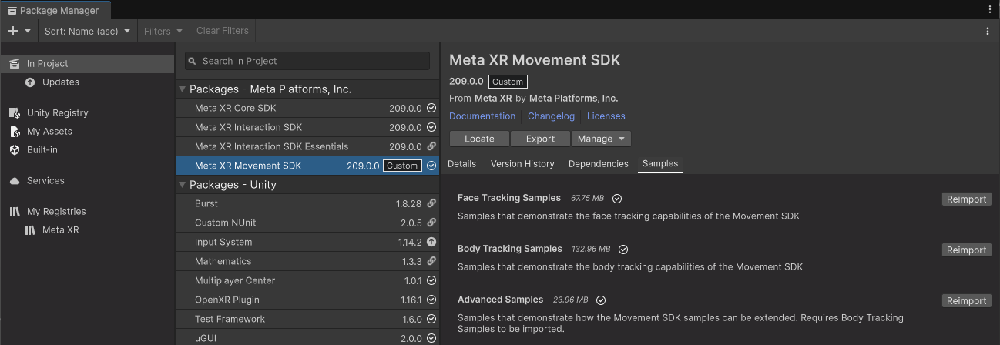
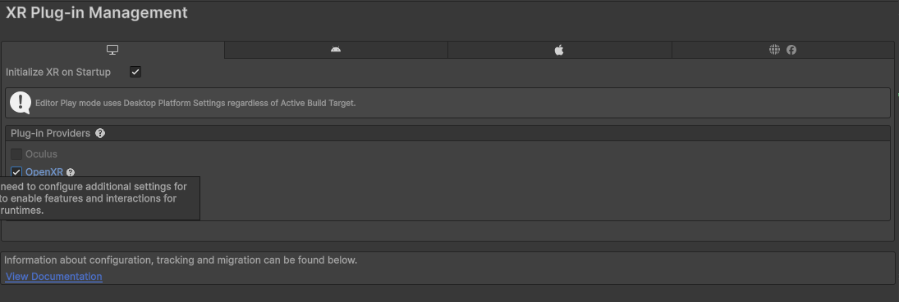
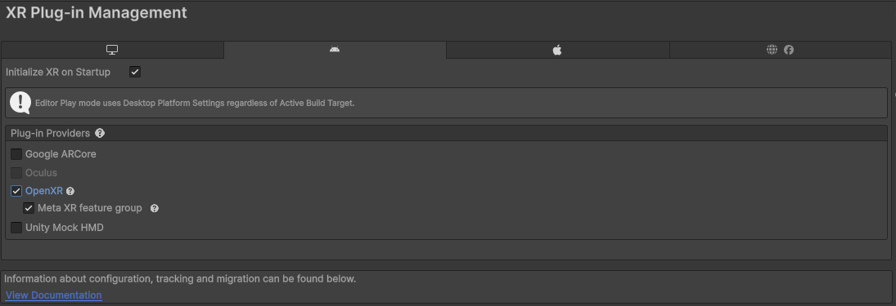
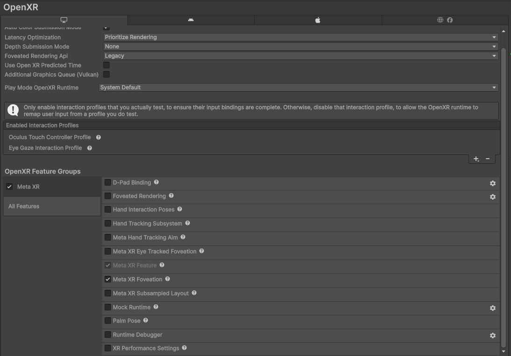
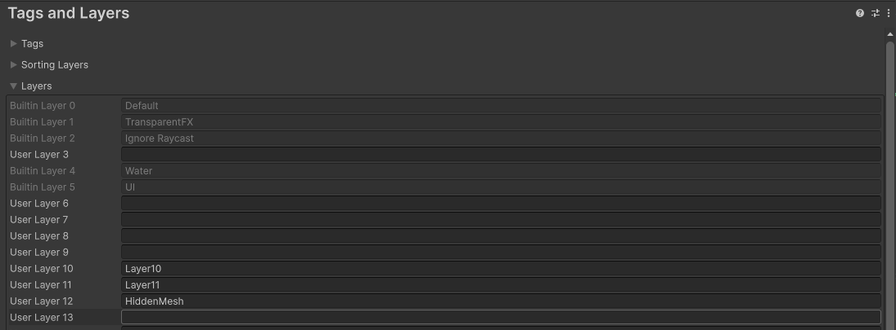
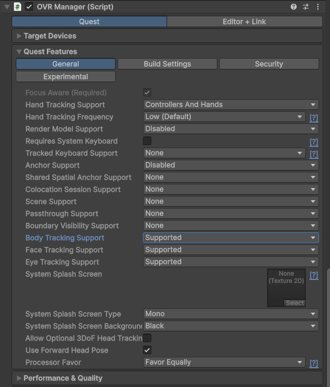
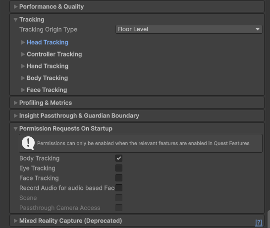
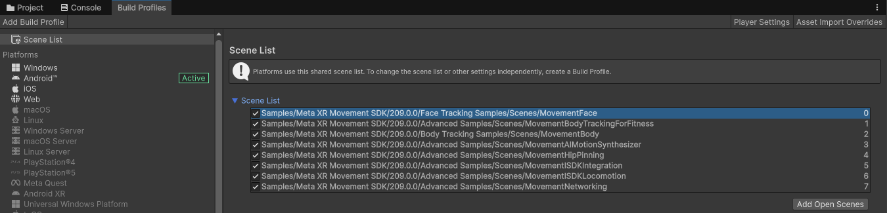

# Setup project Unity 6 cho Movement SDK
{: .no_toc }

<details open markdown="block">
  <summary>Mục lục</summary>
  {: .text-delta }
1. TOC
{:toc}
</details>

---

## 1. Tạo project
{: #step-1 }

Tạo project 3D trống bằng Unity Hub, chọn editor **6000.3.9f1** (hoặc mới hơn, tối thiểu 6000.0.66f2). Nhớ cài module **Android Build Support** nếu sẽ build ra Quest.

Cũng có thể tạo project từ dòng lệnh:

```powershell
& "E:\UnityHub\Editor\6000.3.9f1\Editor\Unity.exe" -batchmode -quit -nographics `
  -createProject "E:\Projects\Unity\UnitySampleMovement\MovementTest"
```

## 2. Cài package
{: #step-2 }

Mở `Packages/manifest.json` và thêm **scoped registry** của Meta cùng các dependency sau:

```json
{
  "dependencies": {
    "com.meta.xr.sdk.core": "209.0.0",
    "com.meta.xr.sdk.interaction.ovr": "209.0.0",
    "com.meta.xr.sdk.movement": "https://github.com/oculus-samples/Unity-Movement.git#v209.0.0",
    "com.unity.xr.openxr": "1.16.1",
    "com.unity.inputsystem": "1.14.2",
    "com.unity.ugui": "2.0.0",
    "com.unity.test-framework": "1.6.0"
  },
  "scopedRegistries": [
    {
      "name": "Meta XR",
      "url": "https://npm.developer.oculus.com",
      "scopes": ["com.meta.xr"]
    }
  ]
}
```

{: .tip }
> Khi phát triển hoặc sửa chính Movement SDK, hãy clone repo về và trỏ package bằng đường dẫn local, ví dụ `"com.meta.xr.sdk.movement": "file:../../Unity-Movement"`. Sửa code trong repo thì project test nhận thay đổi ngay.

{: .warning }
> **Bắt buộc có `com.unity.test-framework`.** Package Movement chứa assembly test `Tests/Editor` cần NUnit. Thiếu package này, project sẽ báo lỗi `CS0246: The type or namespace name 'NUnit' could not be found`. Xem [Issue #1](issues#issue-1).

Cách khác là dùng **Window → Package Manager → + → Add package from git URL…** với URL `https://github.com/oculus-samples/Unity-Movement.git`.

## 3. Import sample
{: #step-3 }

Mở **Package Manager → Meta XR Movement SDK → Samples**, rồi import theo thứ tự:

1. **Body Tracking Samples**
2. **Face Tracking Samples**
3. **Advanced Samples** (cần import Body Tracking Samples trước)



Sample được chép vào `Assets/Samples/Meta XR Movement SDK/209.0.0/`.

| Sample | Scene |
|---|---|
| Body Tracking Samples | `MovementBody` |
| Face Tracking Samples | `MovementFace` |
| Advanced Samples | `MovementAIMotionSynthesizer`, `MovementBodyTrackingForFitness`, `MovementHipPinning`, `MovementISDKIntegration`, `MovementISDKLocomotion`, `MovementNetworking` |

## 4. Cấu hình XR Plug-in Management
{: #step-4 }

Vào **Edit → Project Settings → XR Plug-in Management**.

### Tab Windows (bắt buộc để test bằng Simulator)

Tick **OpenXR** và để **Initialize XR on Startup** ở trạng thái bật. Play mode trong Editor dùng cấu hình của **Standalone/Windows**, không dùng cấu hình Android.



### Tab Android (build ra Quest)

Tick **OpenXR**, hoặc **Oculus** nếu Project Setup Tool đề xuất.



### OpenXR → tab Windows

- **OpenXR Feature Groups**: tick **Meta XR Feature Group**.
- **Enabled Interaction Profiles**: thêm **Oculus Touch Controller Profile**, và **Meta Quest Touch Pro Controller Profile** nếu có.



## 5. Layer
{: #step-5 }

README của package yêu cầu phải có **layer index 10, 11** và layer tên **HiddenMesh**. Thiếu các layer này thì `RecalculateNormals` sẽ hoạt động sai mà không báo lỗi. Các scene sample đặt object vào layer 10 và 11.

Vào **Project Settings → Tags and Layers**:

| Index | Tên |
|---|---|
| 10 | `Layer10` (đặt tên tùy ý, miễn không để trống) |
| 11 | `Layer11` |
| 12 | `HiddenMesh` |



## 6. Project Setup Tool
{: #step-6 }

Mở **Meta → Tools → Project Setup Tool** (hoặc mục *Project setup tool* trong cửa sổ **Meta XR SDK**), rồi bấm **Fix All** cho cả tab **Android** và tab **Windows**.

Nếu góc dưới Editor hiện thông báo *"Project Setup Tool Fix Available: OpenXR must be added to the XR Plugin active loaders"*, bấm **Fix**. Thông báo này nghĩa là có một platform chưa bật OpenXR loader.

{: .note }
> Project Setup Tool có thể tự nâng version OpenXR (ví dụ 1.15.1 lên 1.16.1). Khi Console báo *"The OpenXR package has been updated and Unity must be restarted"*, bạn **phải khởi động lại Unity**. Xem [Issue #4](issues#issue-4).

{: .note }
> Cảnh báo **Built-in Render Pipeline (BiRP)** chỉ mang tính khuyến nghị. Shader của Movement chạy được trên cả BiRP lẫn URP, nhưng Meta khuyên dùng URP.

## 7. OVRManager
{: #step-7 }

Chọn **Camera Rig** (có component `OVRManager`) trong Hierarchy. Mỗi scene sample đều có sẵn Camera Rig. Kiểm tra các mục sau:

1. **Quest Features → General**: Body / Face / Eye Tracking Support = **Supported** hoặc **Required**. Đặt **Hand Tracking Support** = **Controllers And Hands** để test được cả controller lẫn tay.

   

2. **Tracking → Tracking Origin Type** = **Floor Level**.
3. **Tracking → Body Tracking**: Body Tracking Fidelity = **High**, Body Tracking Joint Set = **Full Body**. README gọi nhóm này là *Movement Tracking*.
4. **Permission Requests On Startup**: tick **Body Tracking**, **Eye Tracking**, **Face Tracking**.

   

{: .warning }
> Ảnh trên mới tick **Body Tracking**. Khi dùng scene có face hoặc eye tracking (`MovementFace`…), nhớ tick thêm **Eye Tracking** và **Face Tracking**. Nếu không, app trên Quest sẽ không xin quyền và face/eye tracking sẽ không chạy.

## 8. Build Settings
{: #step-8 }

Thêm các scene sample vào **File → Build Profiles → Scene List**. Nếu không thêm, các nút trong `SceneSelectMenu` của sample sẽ không chuyển được scene.



## 9. Rendering Quality (khuyến nghị)
{: #step-9 }

Các giá trị khuyến nghị trong README của package:

- Skin Weights: **4 bones**
- MSAA **2x** hoặc **4x**
- Texture full resolution
- Shadow: hard + soft, độ phân giải Very High, Stable Fit, khoảng cách 3 m kèm cascade
- Ít nhất 1 pixel light

---

Tiếp theo: [Meta XR Simulator](simulator)
