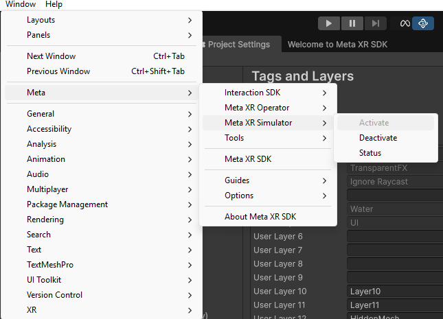
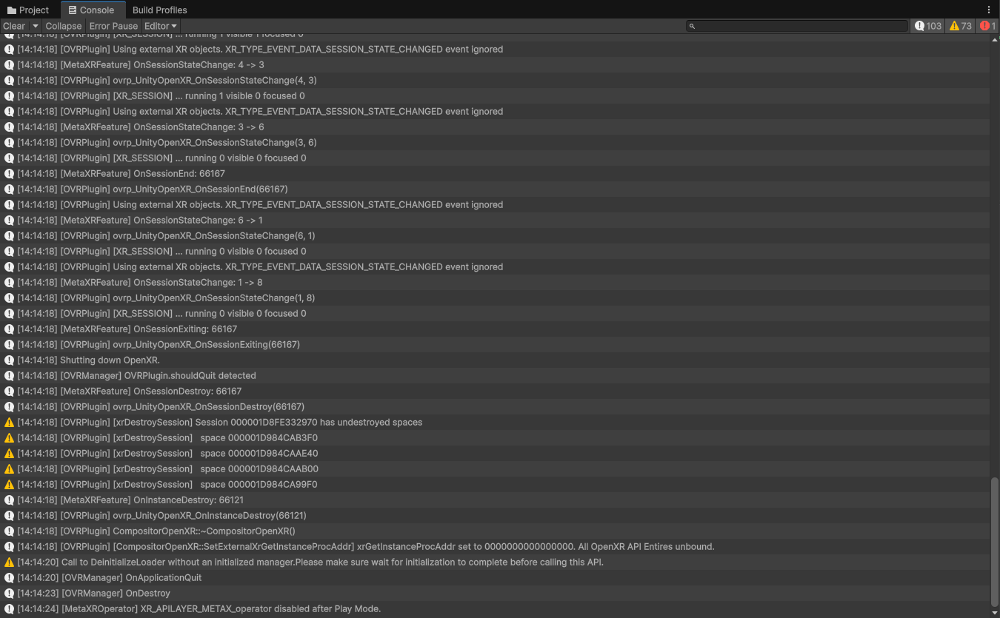
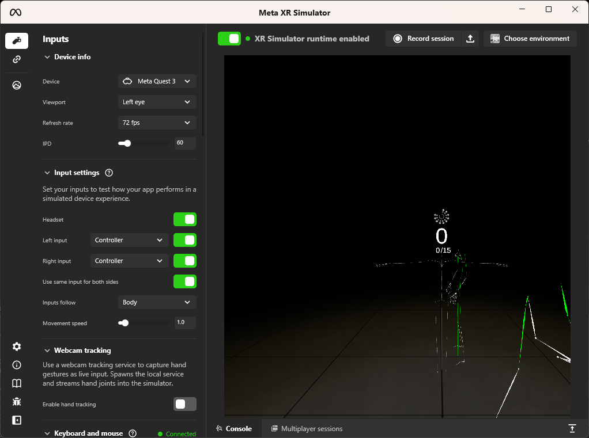
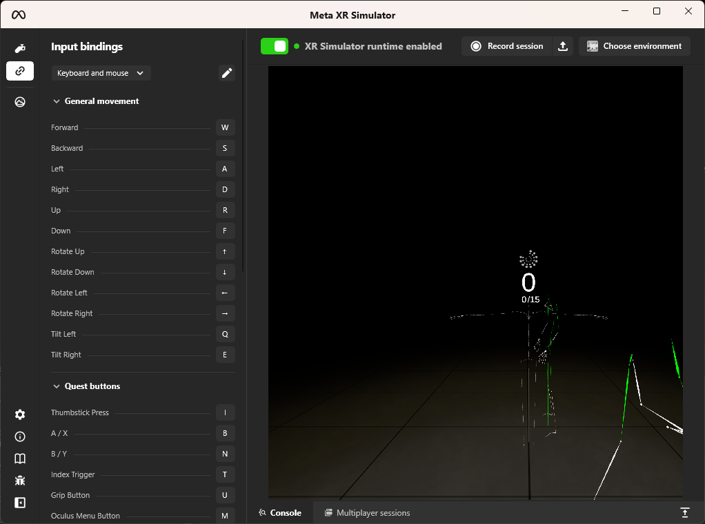

# Test bằng Meta XR Simulator
{: .no_toc }

<details open markdown="block">
  <summary>Mục lục</summary>
  {: .text-delta }
1. TOC
{:toc}
</details>

---

Meta XR Simulator là một OpenXR runtime chạy trên PC. Nó giả lập headset, controller, tay và body tracking, nên bạn bấm Play trong Editor là test được mà không cần Quest.

## 1. Cài Simulator
{: #step-1 }

Mở **Meta → Meta XR Simulator** (hoặc mục *Meta XR Simulator* trong cửa sổ **Meta XR SDK**). Nếu Simulator chưa có, Unity sẽ đề nghị tải bộ cài `.msi`.

{: .warning }
> Unity có thể tải bộ cài thất bại với lỗi `Failed to create file ...\Downloads\meta_xr_simulator.msi` hoặc `Curl error 56`. Khi đó hãy tải bộ cài bằng tay từ Meta Horizon developer center rồi chạy. Xem [Issue #2](issues#issue-2).

Sau khi cài, Simulator nằm ở `C:\Program Files\MetaXRSimulator\v<version>\`.

{: .tip }
> Nên dùng bản Simulator cùng version với Meta XR SDK. Tài liệu này test với Simulator v207.1 và SDK 209.0.0, vẫn chạy được.

## 2. Activate
{: #step-2 }

Vào **Meta → Meta XR Simulator → Activate**. Khi Activate, Unity đặt biến môi trường `XR_SELECTED_RUNTIME_JSON` trỏ tới `meta_openxr_simulator.json`. Kiểm tra lại bằng menu **Status**, kết quả đúng phải là:

```
Meta XR Simulator Status:
• Installed: Yes
• Active: Yes
• Runtime Path: C:\Program Files\MetaXRSimulator\v207.1\meta_openxr_simulator.json
```



{: .important }
> Để Simulator kết nối được, cần đủ 3 điều kiện:
> 1. **XR Plug-in Management → tab Windows** đã tick **OpenXR** ([Setup §4](setup#step-4)).
> 2. Simulator đang ở trạng thái **Activate**.
> 3. Đã khởi động lại Unity nếu OpenXR vừa được nâng version.

Khi kết nối thành công:
- Cửa sổ **Meta XR Simulator** hiện **XR Simulator runtime enabled**.
- Console/Editor.log in ra `Unity OpenXR Diagnostic Report`, trong đó có các extension `XR_FB_body_tracking`, `XR_META_body_tracking_full_body`, `XR_META_body_tracking_fidelity`…
- Console có các log `[MetaXRFeature] OnSessionStateChange`, `[OVRPlugin] ovrp_UnityOpenXR_...`. Lúc thoát Play mode sẽ thấy `Shutting down OpenXR`.



## 3. Input
{: #step-3 }

Mở panel **Inputs** trong cửa sổ Simulator.

| Lựa chọn (Left / Right input) | Nguồn điều khiển |
|---|---|
| **Controller** | Bàn phím + chuột, hoặc tay cầm Xbox (Windows) |
| **Hand** | Bàn phím + chuột (tay cầm Xbox không giả lập được cử chỉ tay) |
| **None** | Không có tay |
| Quest controllers (data forwarding) | Controller Quest thật |
| Camera tracking | Webcam điều khiển tay và hướng nhìn |

**Use same input for both sides** được bật sẵn. Muốn đặt input hai bên khác nhau thì tắt mục này trước.



### Bàn phím và chuột

Phím mặc định, theo panel **Input bindings** của Simulator v207.1:

| Nhóm | Hành động | Phím |
|---|---|---|
| General movement | Tiến / Lùi / Trái / Phải | `W` / `S` / `A` / `D` |
| | Lên / Xuống | `R` / `F` |
| | Xoay lên / xuống / trái / phải | `↑` / `↓` / `←` / `→` |
| | Nghiêng trái / phải | `Q` / `E` |
| Quest buttons | Thumbstick Press | `I` |
| | A / X | `B` |
| | B / Y | `N` |
| | Index Trigger | `T` |
| | Grip Button | `U` |
| | Oculus Menu Button | `M` |

Giữ **chuột phải** rồi rê chuột để nhìn quanh. Cuộn xuống trong **Input bindings** để xem phím thumbstick và **Hand actions** (cử chỉ tay). Bấm biểu tượng bút chì để đổi phím.



{: .note }
> **WASD chỉ di chuyển headset**, tức là mô phỏng người dùng bước đi ngoài đời thật. Thao tác này **không** phát locomotion event (slide, teleport) của Interaction SDK. Muốn locomotion thì phải dùng **thumbstick**. Xem [Demo §3](demo#step-3).

### Tracking controls (body / face)

Mục **Tracking controls** phát lại dữ liệu tracking đã ghi sẵn để test body và face tracking không cần headset. Mục này chỉ hoạt động sau khi app đã khởi động body hoặc face tracker, tức là sau khi bấm Play. Trước đó nó hiện `No movement tracking active`.

Nguồn: [Meta XR Simulator Interaction](https://developers.meta.com/horizon/documentation/unity/xrsim-input-keyboard).

---

Tiếp theo: [Demo Full Body Tracking](demo)
